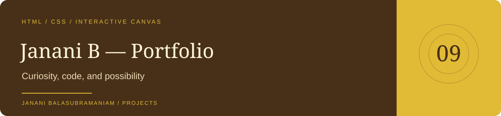

<p align="center"></p>

<p align="center"><a href="https://github.com/Janani-Balasubramanian">GitHub profile</a> · <a href="https://github.com/Janani-Balasubramanian/portfolio">Portfolio</a> · <a href="https://github.com/Janani-Balasubramanian/portfolio/issues">Issues</a></p>

# Janani B — Portfolio

A responsive portfolio for Janani B, a pre-final-year Computer Science and Business Systems student at Rajalakshmi Institute of Technology, Chennai.

## Features

- Brown and mustard theme with a split hero and alternating sections
- Interactive Orbit, Wave, and Galaxy particle formations
- Expandable project descriptions, education, skills, and experience
- Downloadable updated résumé
- Motion pause control and reduced-motion support

## Run locally

The site uses plain HTML, CSS, and JavaScript. No build or installation is required.

```sh
python -m http.server 4173
```

Open http://localhost:4173 in your browser. You can also open `index.html` directly. Google Fonts requires an internet connection; fallback fonts are provided.

## Files

- `index.html` — portfolio content
- `style.css` — layout, colors, and animation styling
- `app.js` — particle interactions and navigation behavior
- `Janani_B_Resume.pdf` — downloadable résumé

Upload the HTML, CSS, JavaScript, and PDF files to a static web host to serve the website.
